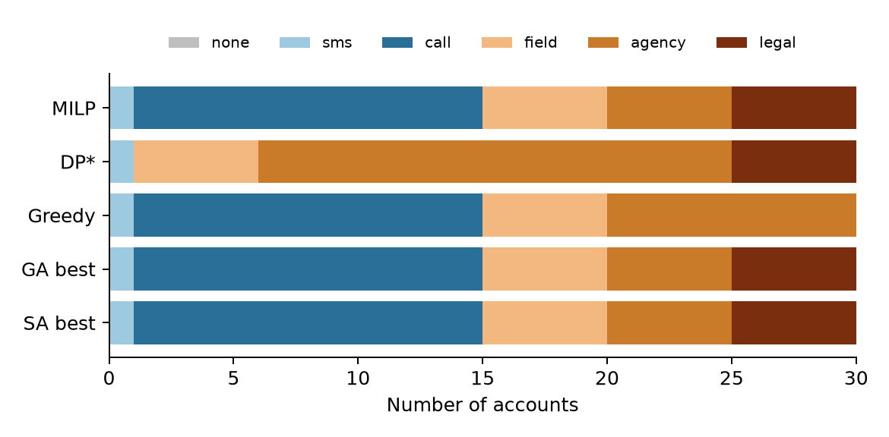
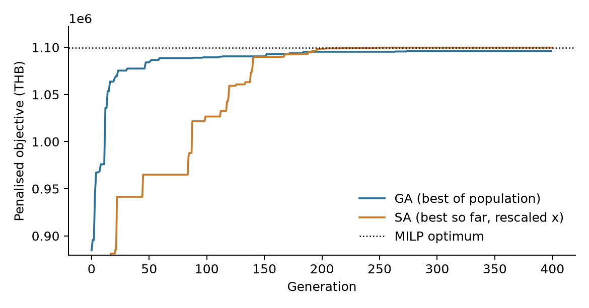
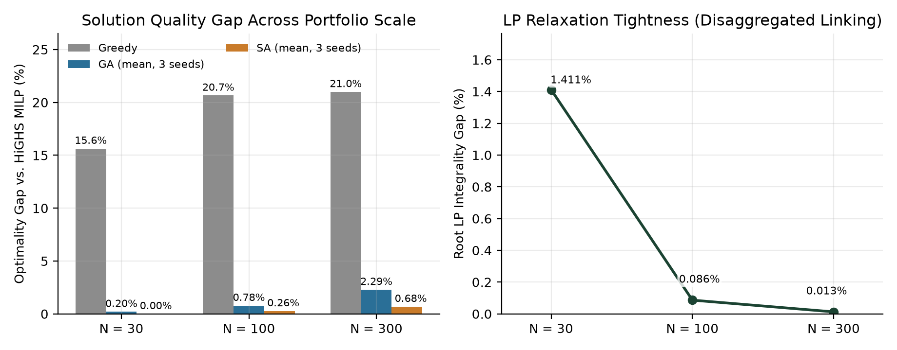
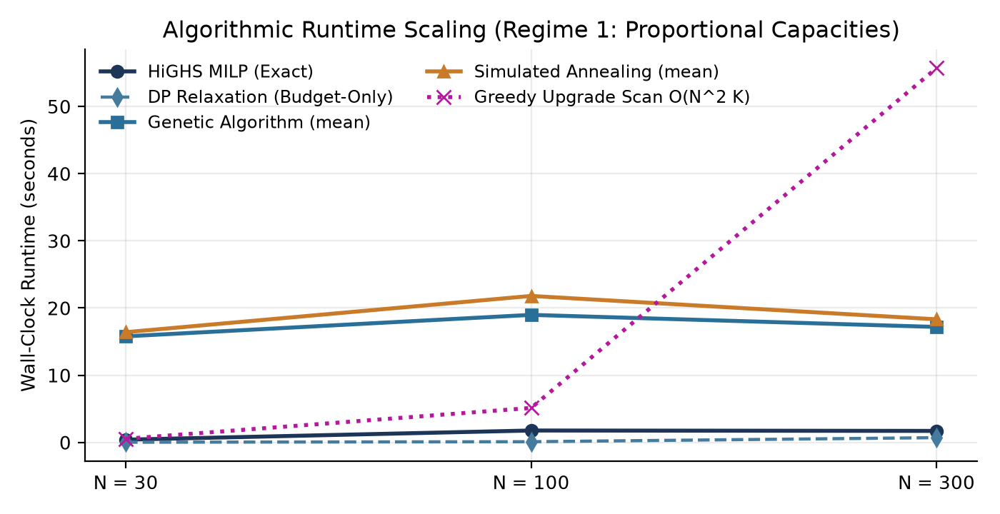
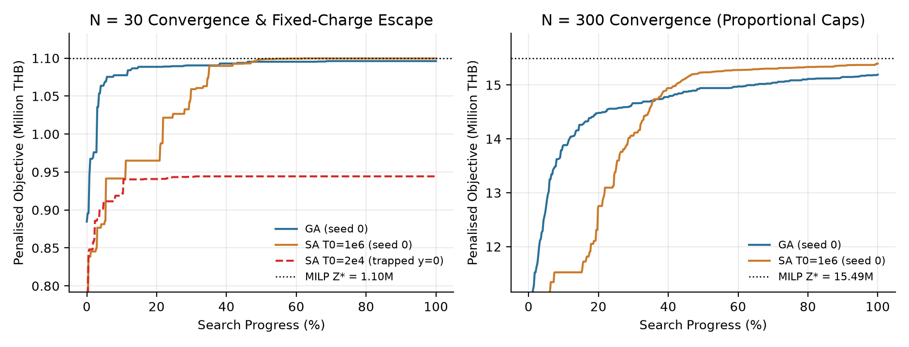
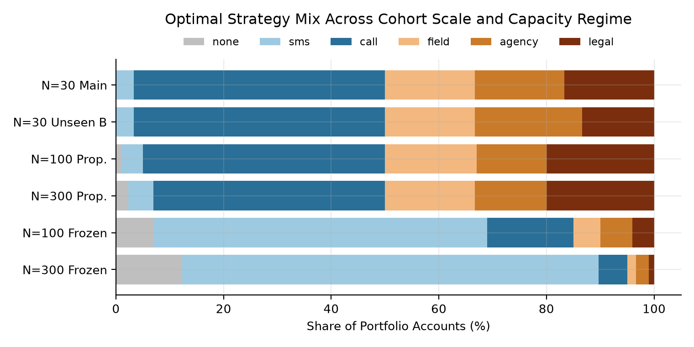
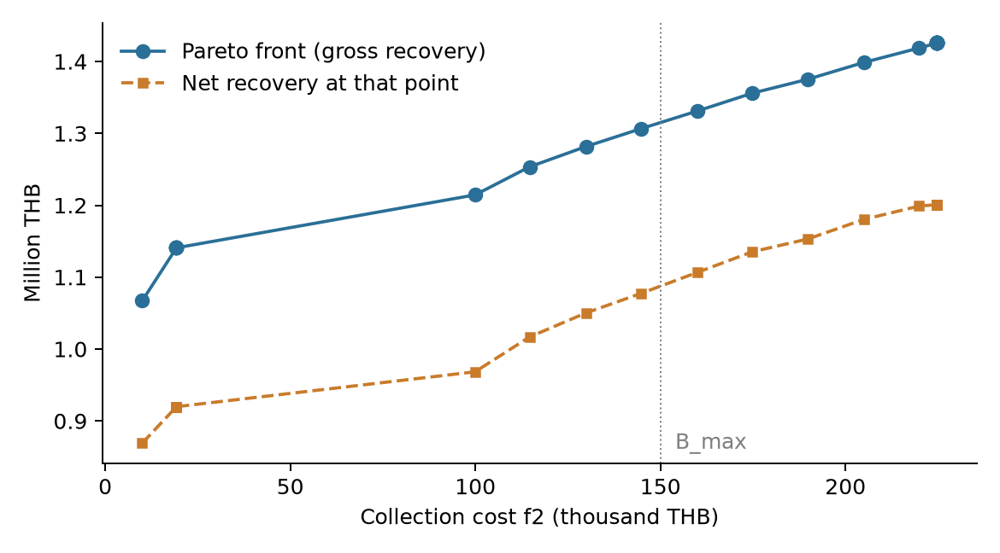

# Debt Collection Strategy Allocation in Thai Baht

**CPE 613 Optimization Methods — Term Project Report (Phase I)**  
**Team Members:** Yuil Tripathee (`69070701612`), Sawit Koseeyaumporn (`69070701621`)  
Mathematical programming and meta-heuristics for assigning collection channels to delinquent loan accounts.

---

## Contents

1. Project summary
2. How the project maps to the CPE 613 midterm
3. Research background
4. Data: from LendingClub to a Thai collection book
5. Recovery model (machine learning)
6. Collection strategies and parameters
7. Mathematical formulation
8. Solution methods
9. Results for the N = 30 instance
10. Sensitivity analysis (shadow prices)
11. Multi-objective analysis (Pareto front)
12. Interactive simulator
13. Reproducing the results
14. Limitations and future work

---

## 1. Project summary

A lender holds a book of delinquent consumer-loan accounts. For each account it can choose one collection
strategy: do nothing, send an SMS/LINE reminder, call, visit, hand the account to an agency, or sue.
Each strategy has a different cost, uses a different scarce resource, and recovers a different expected
amount. The task is to **pick one strategy per account so that the expected net recovery, in THB, is as large
as possible** while staying within the collection budget, call-center hours, field-visit slots, a
customer-conduct cap on hard collection, and the rules for engaging a law firm.

The project has two layers:

| Layer | What it does | Output |
| :--- | :--- | :--- |
| Prediction | A gradient-boosting model trained on 260,640 defaulted LendingClub loans predicts each account's base recovery rate $\rho_i$ | $\rho_i$ for every account |
| Optimization | A mixed-integer linear program (MILP) assigns strategies; it is solved exactly (HiGHS, custom Branch & Bound) and approximately (Greedy, DP relaxation, GA, SA) | Strategy per account, THB recovery, cost, shadow prices, Pareto front |

**Headline result (N = 30 accounts, ฿9.04 M outstanding, budget ฿150,000):**
the exact optimum recovers **฿1,099,661 net** (฿1,295,662 gross) for ฿147,575 of spending, or 7.5 baht net per
baht spent. A value-per-cost greedy rule reaches only ฿927,781 (15.6 % worse). Simulated Annealing found the
optimum in 9 of 10 runs and the Genetic Algorithm in 1 of 10, with a mean gap of 0.44 %.

> **Note on "predicting the grade".** LendingClub's `grade` is assigned when the loan is issued, so it is an
> *input*, not something to predict. What the optimizer needs is the probability and size of recovery
> once an account is in collections. Grade is used as one feature, and on its own it is weak
> (AUC 0.53); the full model reaches AUC 0.77.

---

## 2. How the project maps to the CPE 613 midterm

The midterm (9 Oct 2026) tests seven ideas. The project deliberately reuses each of them on one real problem.

| Midterm problem | Concept tested | Where it appears in this project |
| :--- | :--- | :--- |
| P1 Food-truck festival | MILP with fixed-charge binaries, linking $x \le u\,y$, minimum-activity $L z \le \sum x$, feasible pairs $A$ | Law-firm retainer $F y$, linking $x_{i,5} \le y$, minimum legal cases $L y \le \sum_i x_{i,5}$, eligibility set $A$ (§7) |
| P2 Production planning | LP duality, shadow prices, "should we buy one more unit?" | Duals of budget, call hours, field slots and hard-collection cap; buy/no-buy decisions (§10) |
| P3 Meal selection + B&B pruning | Binary selection with logical constraints; pruning with an incumbent | Must-act rule for DPD ≥ 90; custom Branch & Bound log with bound pruning (§8.2) |
| P4 Max-flow | Network flow, capacity cuts | Discussed as an extension: agents → accounts flow with capacities (§14) |
| P5.1–5.2 DP components, Bellman | Stage / state / decision / value function | DP over accounts with remaining budget as state (§8.3) |
| P5.3–5.5 Reliability | Series / parallel probability | Multi-touch campaigns as "parallel" success probabilities (§6.3) |
| P6 DP vs Greedy | Greedy can be sub-optimal | Greedy is 15.6 % below the optimum (§9) |
| P7 Component allocation + problem size | Counting the solution space | $\prod_i \lvert K_i \rvert = 5.5 \times 10^{21}$ (§7.6) |

The course requirement of a solution space of at least $3 \times 10^6$ is exceeded by fifteen orders of magnitude.

---

## 3. Research background

**Collection strategy optimization in practice.** Banks segment delinquent accounts by risk and value, then
route them to channels of increasing cost and intensity: self-cure, digital reminders, call center, field
visits, external agencies, and litigation. Because call-center agents, field officers and legal budgets are
limited, routing is a resource-allocation problem. Large lenders use exactly this kind of optimization model,
fed by propensity-to-pay or loss-given-default (LGD) models.

**Why expected value.** The decision is made before the outcome is known, so the objective uses expected
recovery $\mathbb{E}[R_{i,k}] = B_i\, r_{i,k}$. This is the standard *risk-neutral* treatment; §14 notes how
to add risk.

**Thai regulatory context.** Collection in Thailand is governed by the *Debt Collection Act B.E. 2558 (2015)*.
It allows only the creditor, its authorised agents or Ministry-of-Justice-licensed collection businesses to
collect. It restricts contact to the debtor (third parties only to locate them), forbids non-discreet
communication such as postcards, and is enforced with administrative fines and criminal penalties.
A 2019 amendment is reported to limit repayment requests to **once per day**. These rules motivate two
modelling choices: the hard-collection cap $M$ (a customer-conduct limit) and limited per-account contact
capacity (agent-hours rather than unlimited calls).
*Sources: Tilleke & Gibbins (2015); Luther Law Firm practice note (2026); Thai PBS World (2024).
The once-per-day rule should be checked against the gazetted text before it is cited formally.*

**Currency.** LendingClub amounts are in USD. They are converted at **33.0 THB/USD**. The October 2026 rate was
about 33.1–33.3, and the 2026 range was 30.9–33.8 (exchange-rates.org, ValutaFX). The rate is a parameter in
both the code and the simulator.

---

## 4. Data: from LendingClub to a Thai collection book

### 4.1 Source and extraction

* **File:** `archive-2/loan.csv`, Kaggle *LendingClub Loan Data*: 2,260,668 loans and 145 columns (1.19 GB).
* **Filter:** `loan_status ∈ {Charged Off, Default, Does not meet the credit policy. Status:Charged Off}`,
  giving **262,447 defaulted loans**. Loans with exposure under $500 are dropped, leaving 260,640.
* **Exposure at default:** $\text{EAD} = \texttt{funded\_amnt} - \texttt{total\_rec\_prncp}$.
* **Observed recovery rate:** $\texttt{recoveries} / \text{EAD}$, clipped to $[0,1]$.

### 4.2 What the data says

| Grade | Defaulted loans | Mean EAD (THB) | P(any recovery) | Mean recovery rate |
| :---: | ---: | ---: | ---: | ---: |
| A | 13,621 | 268,142 | 59.4 % | 10.4 % |
| B | 50,640 | 287,813 | 66.2 % | 10.5 % |
| C | 82,763 | 342,003 | 67.6 % | 10.5 % |
| D | 59,324 | 391,807 | 68.3 % | 10.6 % |
| E | 35,419 | 468,807 | 70.1 % | 10.9 % |
| F | 14,323 | 531,779 | 72.4 % | 11.2 % |
| G | 4,550 | 576,353 | 72.2 % | 11.1 % |

Two observations shaped the model:

1. The average recovery is only about **10.6 % of exposure**. A recovery rate of 0.55 for a call center, as
   in the original README sketch, is not realistic. Strategy effects are therefore modelled as *multipliers* on
   a data-driven base rate.
2. Grade barely separates recovery outcomes, so a richer model is needed (§5).
   Collection fees in the data average **16.6 % of recoveries** across every grade, which is consistent with the
   25 % agency commission used in §6.

### 4.3 The project portfolio

A **300-account pool** is drawn with stratification by grade (A 25, B 50, C 75, D 65, E 45, F 25, G 15), and the
**first 30 accounts form the report instance** (฿9,037,800 outstanding). Two fields that a live Thai
collection book would have but LendingClub does not are **generated** (seed 613) and labelled as synthetic:

| Field | Generation rule | Why |
| :--- | :--- | :--- |
| `dpd` days past due | 30 / 60 / 90 / 120 / 180 with probabilities .30 / .25 / .20 / .15 / .10 | Recovery decays with age and drives the must-act rule |
| `reachable` phone works | Bernoulli(0.85), or 0.70 for grades E–G | Remote channels are weak when the debtor cannot be reached |

Balances: $B_i = 33 \times \text{EAD}_i$, rounded to ฿100.

---

## 5. Recovery model (machine learning)

**Two-part ("hurdle") model.**

$$
\rho_i \;=\; \underbrace{P(\text{recovery}>0 \mid \mathbf{z}_i)}_{\text{classifier}} \;\times\;
\underbrace{\mathbb{E}[\text{rate} \mid \text{recovered}, \mathbf{z}_i]}_{\text{regressor}} \;\times\;
\underbrace{e^{-0.004\,(\text{dpd}_i-30)}}_{\text{age decay}}, \qquad \rho_i \in [0.01, 0.60]
$$

* **Algorithms:** `HistGradientBoostingClassifier` and `HistGradientBoostingRegressor` (scikit-learn), 300 trees,
  learning rate 0.08, with a 75/25 train/test split.
* **Features (24):** grade, sub-grade, interest rate, term, instalment, income, DTI, employment length,
  revolving utilisation and balance, open/total accounts, inquiries, delinquencies, public records,
  bankruptcies, mortgages, EAD, fraction of principal already repaid, late fees, issue year, home ownership,
  verification status and purpose.
* **Leakage control:** `recoveries`, `collection_recovery_fee` and `total_pymnt` (which includes recoveries)
  are excluded.

| Test-set metric | Value |
| :--- | ---: |
| AUC, full classifier | **0.766** |
| AUC, grade only | 0.530 |
| Brier score | 0.172 |
| MAE of rate, given recovery | 0.077 |
| Mean actual / predicted rate | 0.1061 / 0.1061 |

On the N = 30 instance, $\rho_i$ ranges from 1.1 % to 16.6 % with a mean of 8.5 %.

---

## 6. Collection strategies and parameters

### 6.1 Strategy table (all money in THB)

| $k$ | Strategy | Thai | Lift $\lambda_k$ | Cost $c_{i,k}$ | Commission $\varphi_k$ | Resource used |
| :-: | :--- | :--- | :-: | :--- | :-: | :--- |
| 0 | No action / self-cure | ไม่ดำเนินการ | 0.30 | 0 | – | – |
| 1 | SMS + LINE OA reminder | SMS / LINE | 0.55 | 25 | – | – |
| 2 | In-house call center | คอลเซ็นเตอร์ | 1.00 | 350 | – | 0.75 agent-hours |
| 3 | Field collector visit | ลงพื้นที่ | 1.40 | 1,800 | – | 1 field slot |
| 4 | External collection agency | บริษัทติดตามหนี้ | 1.70 | 500 | 25 % | hard-collection cap |
| 5 | Legal action (law firm) | ดำเนินคดี | 2.30 | 8,000 + 2 % of $B_i$ | – | hard-collection cap, retainer |

The call center is the reference channel ($\lambda = 1$), matched to the historical recovery level.
Costs are planning assumptions for a Thai lender (SMS gateway, agent time, travel, handover fee, court
fee and lawyer fee). They are editable in the simulator.

### 6.2 Recovery rate per account and strategy

$$
r_{i,k} = \min\!\big(0.90,\; \rho_i\,\lambda_k\,u_{i,k}\big),\qquad
u_{i,k} = \begin{cases} 0.40 & k\in\{1,2\} \text{ and phone unreachable} \\ 1 & \text{otherwise}\end{cases}
$$

$$
\mathbb{E}[R_{i,k}] = B_i\,r_{i,k}, \qquad
v_{i,k} = \mathbb{E}[R_{i,k}]\,(1-\varphi_k) - c_{i,k}\quad\text{(true net value)}
$$

### 6.3 Reliability view of multi-touch campaigns (link to midterm P5)

If a campaign uses several independent touches, each with success probability $p_j$, the account pays if *at
least one* touch works. This is the same formula as a parallel system:
$P = 1 - \prod_j (1-p_j)$. For example, an SMS (0.05) followed by a call (0.09) gives
$1 - 0.95 \times 0.91 = 0.1355$, less than the 0.14 you would get by adding them. Combination strategies can
be added to the model as extra columns $k$ with $\lambda$ derived this way, without changing the formulation.

---

## 7. Mathematical formulation

### 7.1 Sets

* $I = \{1,\dots,N\}$: delinquent accounts ($N = 30$ in the report).
* $K = \{0,\dots,5\}$: strategies (§6.1).
* $A \subseteq I\times K$: allowed account–strategy pairs. $(i,5)\notin A$ if $B_i < ฿100{,}000$
  (legal action is not worth it for small claims), and $(i,0)\notin A$ if $\text{dpd}_i \ge 90$
  (old accounts must be worked).

### 7.2 Parameters

| Symbol | Meaning | Default |
| :--- | :--- | ---: |
| $B_i$ | outstanding balance (THB) | data |
| $\mathbb{E}[R_{i,k}],\ c_{i,k},\ \varphi_k$ | expected recovery, direct cost, commission | §6 |
| $h_k$ | agent-hours per account ($h_2 = 0.75$, else 0) | 0.75 |
| $B_{\max}$ | collection budget | ฿150,000 |
| $H$ | call-center agent-hours | 12 |
| $V$ | field-visit slots | 5 |
| $M$ | max accounts in hard collection (agency + legal) | 10 |
| $F$ | law-firm retainer, paid once if any case is filed | ฿40,000 |
| $L$ | minimum number of cases if the firm is engaged | 3 |
| $w_i$ | account priority weight (equal, or by balance, DPD or grade, in $[1,1.5]$) | 1 |
| $\pi_k$ | strategy priority weight, $[0.5,1.5]$ | 1 |

### 7.3 Decision variables

$$
x_{i,k} = \begin{cases}1 & \text{strategy } k \text{ assigned to account } i\\0&\text{otherwise}\end{cases}\quad (i,k)\in A,
\qquad
y = \begin{cases}1 & \text{law firm engaged}\\0&\text{otherwise}\end{cases}
$$

### 7.4 Single-objective MILP

$$
\max_{x,y}\; Z = \sum_{(i,k)\in A} \Big( w_i\,\pi_k\,\mathbb{E}[R_{i,k}]\,(1-\varphi_k) - c_{i,k} \Big)\,x_{i,k} \;-\; F\,y
$$

subject to

$$
\begin{aligned}
&\textstyle\sum_{k:(i,k)\in A} x_{i,k} = 1 && \forall i\in I && \text{(one strategy per account)}\\
&\textstyle\sum_{(i,k)\in A} c_{i,k}\,x_{i,k} + F\,y \le B_{\max} && && \text{(budget)}\\
&\textstyle\sum_{i} h_2\,x_{i,2} \le H && && \text{(call-center hours)}\\
&\textstyle\sum_{i} x_{i,3} \le V && && \text{(field visits)}\\
&\textstyle\sum_{i} (x_{i,4}+x_{i,5}) \le M && && \text{(hard-collection cap)}\\
&x_{i,5} \le y && \forall i:(i,5)\in A && \text{(legal only if firm engaged)}\\
&L\,y \le \textstyle\sum_{i} x_{i,5} && && \text{(minimum legal package)}\\
&x_{i,k}\in\{0,1\},\; y\in\{0,1\}
\end{aligned}
$$

With $w_i = \pi_k = 1$ the objective is the true expected net recovery. Other weights express business
priorities, for example a customer-friendly policy that favours softer channels. Reported THB figures always
use the unweighted values $v_{i,k}$.

**Modelling notes (midterm P1 patterns).** $F y$ is a *fixed charge*. The disaggregated linking
$x_{i,5}\le y$ gives a tighter LP relaxation than the aggregated $\sum_i x_{i,5}\le N y$. The pair
$L y \le \sum_i x_{i,5}$ together with linking reproduces the midterm's "if served, at least $L_i$" structure.
Restricting variables to $A$ reproduces its feasible-pair set.

### 7.5 Multi-objective formulation

$$
\begin{aligned}
\max\; f_1(\mathbf{x}) &= \textstyle\sum_{(i,k)\in A}\mathbb{E}[R_{i,k}]\,x_{i,k} && \text{(gross expected recovery)}\\
\min\; f_2(\mathbf{x},y) &= \textstyle\sum_{(i,k)\in A}c_{i,k}\,x_{i,k} + F y && \text{(collection cost)}
\end{aligned}
$$

The two objectives conflict and are solved with the **ε-constraint method**: maximise $f_1$ subject to
$f_2 \le \varepsilon$ and all other constraints, sweeping $\varepsilon$.

### 7.6 Size of the solution space (midterm P7.2 style)

Without restrictions there are $6^{30}\approx 2.2\times10^{23}$ assignments. With the allowed set $A$, the
N = 30 instance has 1 account with 4 options, 18 with 5 and 11 with 6:

$$
\prod_{i}\lvert K_i\rvert = 4^{1}\cdot 5^{18}\cdot 6^{11} \approx 5.54\times 10^{21} \;\gg\; 3\times10^{6}.
$$

At $10^9$ evaluations per second, full enumeration would take about 175,000 years.

---

## 8. Solution methods

| Method | Type | Implementation | Guarantees |
| :--- | :--- | :--- | :--- |
| MILP | exact | HiGHS via `scipy.optimize.milp` (Python) and `highs-js` (browser) | global optimum |
| Branch & Bound | exact | hand-written, LP relaxations with `linprog` | global optimum, with a node log |
| LP relaxation | bound + duals | HiGHS LP | upper bound; shadow prices |
| Dynamic Programming | exact for a relaxation | NumPy, budget as state | optimum of the budget-only problem |
| Greedy | heuristic | value per baht | none |
| Genetic Algorithm | meta-heuristic | custom | none |
| Simulated Annealing | meta-heuristic | custom | none |

### 8.1 Exact MILP

The N = 30 instance has 160 binary $x_{i,k}$ (one per allowed pair) plus $y$. Its constraints are 30 assignment rows, 4 resource rows, 26 linking rows (one per legal-eligible account) and 1 minimum-case row. HiGHS solves it by branch-and-cut in **0.05 s**.

### 8.2 Custom Branch & Bound (midterm P3.2 logic)

* Search is best-bound first, branching on the most fractional variable, with $y$ branched first.
* The starting incumbent is the Greedy solution (฿927,781).
* A node is **pruned** when its LP bound is no better than the incumbent, which is exactly the pruning
  rule in midterm P3.2.

| Statistic | Value |
| :--- | ---: |
| Root LP bound | ฿1,115,180 (17 fractional variables) |
| Nodes explored | 6,267 |
| Nodes pruned by bound | 3,133 |
| Integer leaves found | 1 |
| Result | ฿1,099,661, proved optimal (open list empty) |
| Integrality gap of the root | 1.39 % |

### 8.3 Dynamic Programming (midterm P5.1, P5.2)

Keeping only the budget constraint, the problem becomes a *multiple-choice knapsack*, which DP solves exactly.

* **Stage** $s$: account $s$, processed backwards from $N$ to 1.
* **State** $b$: remaining budget, in units of ฿100.
* **Decision** $k$: the strategy for account $s$.
* **Value function**: $f_s(b) = \max_{k:(s,k)\in A,\ \lceil c_{s,k}\rceil\le b}\ \big\{ W_{s,k} + f_{s+1}(b - \lceil c_{s,k}\rceil) \big\}$, with $f_{N+1}(\cdot)=0$.
* **Retainer** $F$: the DP is solved twice, once with $y=0$ (legal forbidden) and once with $y=1$ (budget $B_{\max}-F$), and the better result is kept.
* **Bellman's principle**: whatever was spent on earlier accounts, the remaining assignments must be optimal for the remaining budget.

With capacity constraints the state would need to be (budget, hours, visits, hard cases). The state space
grows multiplicatively, which is the *curse of dimensionality*. This is why DP is used here as a relaxation
and bound, not as the main solver.

### 8.4 Greedy (midterm P6 analogue)

The greedy rule starts each account on its cheapest allowed strategy. It then repeatedly applies the single
upgrade with the highest gain in value per extra baht that keeps every constraint satisfied.

### 8.5 Genetic Algorithm

* **Chromosome:** an integer vector $\mathbf{a}\in K^N$, with gene $a_i$ the strategy of account $i$. Genes are sampled only from allowed strategies.
* **Fitness:** $Z(\mathbf{a}) - 10^5\cdot\text{viol}(\mathbf{a})$, where viol sums budget overrun per ฿1,000 and 10 × each unit of capacity overrun. $y$ is implied: $y=1$ if any gene equals 5.
* **Operators:** tournament selection (size 3), uniform crossover ($p_c=0.9$), per-gene mutation ($p_m=1.5/N$) and 2 elites.
* **Settings:** population 120, 400 generations.

### 8.6 Simulated Annealing

* **Moves:** change one gene, plus a swap with probability 0.3.
* **Acceptance:** Metropolis, accepting a worse move with probability $e^{\Delta/T}$.
* **Schedule:** $T_0 = 10^6$, geometric cooling with $\alpha = 0.99975$, 60,000 iterations.

**Lesson learned.** With $T_0 = 2\times10^4$, SA stalled at ฿944,293 on every seed. Engaging the law firm
requires paying $F$ and filing at least $L=3$ cases *at once*, so single-gene moves meet a deep valley in the
objective. Raising $T_0$ to $10^6$ let the search cross it.

---

## 9. Results for the N = 30 instance

### 9.1 Method comparison

| Method | Objective / net recovery | Cost | Gap to optimum | Time | Feasible |
| :--- | ---: | ---: | ---: | ---: | :-: |
| **MILP (HiGHS)** | **฿1,099,661** | ฿147,575 | 0.00 % | 0.05 s | yes |
| Custom B&B | ฿1,099,661 | ฿147,575 | 0.00 % | 5.4 s | yes |
| LP relaxation (bound) | ฿1,115,180 | – | −1.41 % | <0.01 s | fractional |
| DP, budget only | ฿1,148,052 | ฿149,675 | −4.40 % | <0.01 s | **no**: 24 hard-collection cases exceed $M=10$ and 0 calls |
| Greedy | ฿927,781 | ฿18,925 | 15.63 % | 0.05 s | yes |
| GA (10 seeds) | best ฿1,099,661 · mean ฿1,094,869 · sd ฿4,422 | ฿147,575 | 0.44 % mean | 1.8 s | 10/10 |
| SA (10 seeds) | best ฿1,099,661 · mean ฿1,099,138 · sd ฿1,572 | ฿147,575 | 0.05 % mean | 1.9 s | 10/10 |

Negative gaps are relaxations, so they are upper bounds. The ordering
$Z_{\text{DP}} \ge Z_{\text{LP}} \ge Z^{*}$ is the expected bound hierarchy.

**Why Greedy fails.** The ratio rule never engages the law firm. A single legal case cannot pay for the
฿40,000 retainer, and it would also break the minimum of three cases. Greedy therefore spends only ฿18,925 of
the budget and pushes accounts to the agency instead, paying ฿175,000 in commission. This is the midterm P6
lesson: decisions that look best locally can block the best combined plan.

### 9.2 Optimal plan

| Strategy | Accounts | Mean balance | Mean $\rho_i$ |
| :--- | :-: | ---: | ---: |
| Legal action | 5 | ฿511,500 | 12.6 % |
| Field visit | 5 | ฿393,760 | 9.2 % |
| External agency | 5 | ฿444,260 | 6.2 % |
| Call center | 14 | ฿160,607 | 8.1 % |
| SMS / LINE | 1 | ฿41,700 | 1.4 % |
| No action | 0 | – | – |

The model sends the largest and best-recovering balances to legal action. Large balances with lower $\rho_i$
or unreachable phones go to field visits and the agency, and the call center handles mid-sized accounts.
Budget (98 %), field slots (5/5) and the hard-collection cap (10/10) are binding. Call-center hours (10.5/12)
are not. The full account list is in `data/optimal_assignment_N30.csv`.





### 9.3 Scaling, Held-Out Validation, and SA Temperature Ablation (`03b_phase1_benchmark.py`)

To evaluate algorithmic scaling across the full 300-account pool and verify out-of-sample stability on unseen accounts (`TH0031–TH0060`), we executed 3-seed benchmarks (`seeds = 0, 1, 2`) under two capacity regimes while holding institutional law-firm contract parameters invariant ($F = ฿40{,}000$, $L = 3$):
1. **Regime 1 (Proportional Operational Capacities):** $B_{\max}, H, V, M$ scale by $N/30$ (`×3.33` for $N=100$, `×10` for $N=300$).
2. **Regime 2 (Frozen Baseline Capacities):** $B_{\max}, H, V, M$ remain fixed at $N=30$ limits (`฿150k, 12h, 5 slots, 10 hard-cap`) under $3.3\times$ and $10\times$ portfolio load.

| Instance & Regime | Vars / Cons | MILP $Z^*$ (THB) | MILP Time | Root LP Gap | Greedy Gap (Time) | GA Mean Gap (Time) | SA Mean Gap (Time) |
| :--- | :---: | ---: | :---: | :---: | :---: | :---: | :---: |
| **`N30_main`** | 161 / 61 | `1,099,661.34` | `0.40 s` | `1.411%` | `15.63%` (`0.54 s`) | `0.202%` (`15.78 s`) | `0.000%` (`16.40 s`) |
| **`N30_unseenB`** | 157 / 61 | `1,365,227.21` | `0.56 s` | `1.929%` | `14.38%` (`0.32 s`) | `0.568%` (`14.56 s`) | `0.000%` (`17.75 s`) |
| **`N100_prop`** | 533 / 191 | `4,260,700.84` | `1.77 s` | `0.086%` | `20.65%` (`5.13 s`) | `0.778%` (`18.97 s`) | `0.265%` (`21.79 s`) |
| **`N300_prop`** | 1625 / 576 | `15,493,104.26` | `1.71 s` | `0.013%` | `20.99%` (`55.70 s`) | `2.287%` (`17.18 s`) | `0.683%` (`18.31 s`) |
| **`N100_frozen`** | 533 / 191 | `2,803,548.13` | `1.61 s` | `1.269%` | `9.50%` (`2.30 s`) | `3.123%` (`14.34 s`) | `0.456%` (`16.35 s`) |
| **`N300_frozen`** | 1625 / 576 | `7,158,140.96` | `2.01 s` | `1.280%` | `4.19%` (`19.23 s`) | `3.941%` (`21.96 s`) | `2.914%` (`29.35 s`) |

* **Paired Statistical Comparison (18 matched runs):** Across all 6 instances $\times$ 3 seeds, SA achieved a pooled mean gap of **`0.720%`** vs GA's **`1.816%`** (two-sided Wilcoxon signed-rank test, $p = 0.00035$). Uniform crossover disrupts constrained resource allocations at $N=300$, whereas SA's 1-gene/swap moves preserve near-saturated budget efficiency.
* **Custom B&B Scaling:** `N30_unseenB` closed optimality in `1,697` nodes (`11.80 s`), whereas on `N100_prop` a `1,000`-node budget (`37.43 s`) stalled at the Greedy incumbent (`฿3,380,802`), illustrating exponential worst-case growth relative to bounded-time meta-heuristics.
* **SA Retainer-Barrier Ablation ($N=30$, 3 seeds):** Lowering $T_0$ from `1,000,000` to `20,000` trapped `3/3` seeds at `฿944,293.22` (`14.13%` gap, `y=0`, zero legal cases), empirically confirming the fixed-charge energy barrier.
* **Frozen-Capacity Shadow Prices:** Holding staff fixed up to $N=300$ drives SMS/LINE usage from `3.3%` to `77.3%` (`232/300` accounts) while elevating call-hour marginal value from `฿0` to `฿42,910/h` and field-visit marginal value to `฿71,653/visit`.









---

## 10. Sensitivity analysis (shadow prices, midterm P2 logic)

LP-relaxation duals and exact MILP re-solves with one more unit of each resource:

| Resource | LP shadow price | MILP gain for +1 unit | Price of one more unit (assumed) | Decision |
| :--- | ---: | ---: | ---: | :--- |
| Budget | ฿1.28 per ฿1 | ฿5,304 per ฿1,000 | ฿1 per ฿1 | **Increase the budget**: each baht returns about ฿1.3–5.3 |
| Call-center hours | ฿0 | ฿0 | about ฿250 per hour of overtime | **Do not buy**: not binding |
| Field slots | ฿7,687 per visit | ฿9,283 | about ฿2,500 per extra officer-day | **Buy**: net gain about ฿5,000–6,800 |
| Hard-collection cap | ฿7,113 per account | ฿7,049 | policy, not money | Shows what the customer-conduct policy costs |

The MILP gain for +฿1,000 of budget (฿5.3 per baht) is far above the LP dual of ฿1.28. Integer problems are
"lumpy": the extra ฿1,000 lets the model rearrange several assignments at once. LP duals are therefore a
first estimate, and the re-solve is the reliable figure. The midterm's dual argument holds exactly only for
LPs.

---

## 11. Multi-objective analysis (Pareto front)

ε-constraint sweep, ε from ฿10,000 to ฿400,000, keeping only distinct non-dominated points:

| Cost $f_2$ | Gross $f_1$ | Net | Plan (none / sms / call / field / agency / legal) |
| ---: | ---: | ---: | :--- |
| ฿10,000 | ฿1,067,134 | ฿869,147 | 2 / 4 / 14 / 0 / 10 / 0 |
| ฿19,250 | ฿1,140,836 | ฿919,846 | 0 / 0 / 15 / 5 / 10 / 0 |
| ฿99,929 | ฿1,214,409 | ฿968,358 | 1 / 5 / 9 / 5 / 7 / 3 |
| ฿144,838 | ฿1,306,668 | ฿1,077,553 | 0 / 0 / 15 / 5 / 5 / 5 |
| ฿189,815 | ฿1,375,245 | ฿1,153,068 | 0 / 1 / 14 / 5 / 2 / 8 |
| ฿224,776 | ฿1,425,646 | ฿1,200,870 | 0 / 0 / 15 / 5 / 0 / 10 |



* **Plateau from ฿19k to ฿100k.** The legal channel needs at least $F + 3\times$(case cost), about ฿80k, before
  it can be used. Below that threshold, extra money buys nothing, because field slots and the hard cap are
  already full.
* **Beyond ฿225k the front is flat.** With the hard-collection cap $M$ at 10, every hard case is already legal.
  More recovery would need a policy change, not more money.
* **Gross vs. net.** Agency cases rank high on gross recovery but lose 25 % to commission, so the plan that is
  best on net recovery (§9) is not the plan that is best on gross recovery for the same budget.

---

## 12. Interactive simulator

**File:** `frontend/index.html`, a single self-contained page; open it in any modern browser.

* **Data:** the 300-account pool is embedded; choose N from 5 to 300.
* **Controls:** budget, call hours, field slots, hard-collection cap, retainer, minimum legal cases, legal
  threshold, must-act DPD, FX rate and account-priority mode.
* **Strategy editor:** lift, cost and commission for each strategy, an on/off switch, and a **priority slider
  π<sub>k</sub>**. Presets: *Neutral*, *Customer-friendly* (favours SMS and calls, discourages legal) and
  *Aggressive recovery*.
* **Run optimization:** runs the exact MILP (HiGHS compiled to WebAssembly, `highs@1.15.3`), Greedy, GA and SA.
  It shows THB KPIs, the method comparison with gap to the optimum, the strategy mix, resource utilisation with
  LP shadow prices, the convergence chart and the full assignment table.
* **Pareto front:** an ε-constraint sweep with 21 HiGHS solves.
* **Light/dark theme toggle.**
* **Verified:** on the default N = 30 instance the browser solver returns ฿1,099,661.34, identical to Python.
* **Offline:** HiGHS and Chart.js load from CDNs. Without internet the heuristics still run, but the exact
  solver and charts do not.

---

## 13. Reproducing the results

```bash
uv venv .venv && uv pip install --python .venv/bin/python pandas numpy scikit-learn scipy matplotlib markdown pymdown-extensions
.venv/bin/python src/01_explore.py            # extract the 262k defaulted loans -> data/defaulted_raw.csv.gz
.venv/bin/python src/02_model_and_dataset.py  # train the model, build the THB pool -> data/accounts_*.csv
.venv/bin/python src/03_run_experiments.py    # all solvers, sensitivity, Pareto, figures -> data/, docs/
.venv/bin/python src/03b_phase1_benchmark.py # Phase I scaling (N=30,100,300), unseen B, ablation -> data/, docs/
.venv/bin/python src/04_build_frontend.py     # embed data -> frontend/index.html
.venv/bin/python src/05_build_pdf.py          # this report -> docs/DOCUMENTATION.pdf
```

| Path | Contents |
| :--- | :--- |
| `src/optimizer.py` | model and every solver |
| `src/03b_phase1_benchmark.py` | reproducible Phase I scaling, ablation, stats & `fig_p1_*.png` |
| `data/accounts_N30.csv`, `data/accounts_pool.csv` | report instance and 300-account pool |
| `data/model_report.json` | ML metrics and grade profile |
| `data/results_N30.json`, `data/optimal_assignment_N30.csv` | full baseline results |
| `data/phase1_benchmark.json`, `data/phase1_*.csv` | Phase I scaling logs, seed table, statistical summaries |
| `docs/PHASE1_MEMO.md` | concise Phase I engineering memo |
| `docs/fig_*.png` | figures |
| `frontend/template.html` → `frontend/index.html` | simulator source and built page |

The random seed is 613 throughout.

---

## 14. Limitations and future work

* **Strategy lifts $\lambda_k$ are assumptions.** LendingClub does not record which channel produced each
  recovery. A real deployment would estimate $\lambda_k$ from A/B tests or uplift models.
* **Synthetic fields.** `dpd` and `reachable` are generated; real collection data would replace them.
* **Single period.** A multi-period model (SMS this week, call next week if unpaid) is a natural DP or
  stochastic-programming extension with state "still unpaid".
* **Risk.** The objective is risk-neutral. Chance constraints or CVaR on recovery would protect against
  high-variance plans that rely heavily on legal action.
* **Network view (midterm P4).** Agents with skills and accounts with language or region needs form a
  bipartite flow network. Max-flow / min-cost-flow could plan agent rosters before strategy assignment.
* **Scale.** The full 300-account pool, with all capacities scaled ×10, solves to optimality in 0.31 s with HiGHS in Python. For portfolios of
  10⁵ accounts, a Lagrangian relaxation of the budget constraint decomposes the problem per account.
